<p align="center"></p>

<h1 align="center">QuadMotion</h1>

<p align="center"><b>Живой маскот для терминала.</b> Каждый кадр — настоящие символы Unicode
<code>▘▝▀▖▌▞▛▗▚▐▜▄▙▟█</code>, два цвета на ячейку, без мерцания.<br>
Без зависимостей · Node 20+ · ANSI · Ink · мод Claude Code · SVG · Agent Skill</p>

---

## Pip

Pip — кукла из маленьких нарисованных частей: корпус в пяти вариантах сжатия и
растяжения, глаза, рот, руки, ноги, антенна с лампочкой. Код только расставляет
части по целым субпикселям, поэтому силуэт не «дрожит». Опора идёт от ступней:
стоящая нога не скользит, тело ставится по ногам. Каждое действие строится по
одной грамматике, подсмотренной у маскота Claude Code: предвкушение, действие,
удержание контакта, доводка, возврат в нейтральную позу.

```bash
node src/cli.mjs play      # Pip прямо в терминале: ←/→, Shift, Space, Enter, 1-9
```

Интерактивная версия в браузере — [`docs/showcase/index.html`](docs/showcase/index.html):
клик по Pip вызывает реакцию, клик по земле — идёт туда, стрелки ходят, Shift бежит,
пробел прыгает, кнопки запускают сценки с предметами и погодой.

### Сценки

| | |
| :---: | :---: |
| <br>**Прыжок через ящик** — шаг с опорными ступнями, взгляд, присед, дуга, приземление с пылью | <br>**Мяч** — следит глазами, замах, удар с задержкой на контакте, «Гол!» |
| <br>**Яблоко** — замечает, подстраивается мелкими шагами, ловит, ест в три укуса | <br>**Бабочка** — садится на лампочку, глаза в кучку, «а-а-апчхи!» |
| <br>**Дождь** — первая капля по лампочке, зонт раскрывается, прыжок в лужу | <br>**Ночь** — звёзды, зевок, сон с «z Z z», утро и потягивание |
| <br>**Работа** — печатает, думает, прогресс, «✓» — так выглядит вызов инструмента | <br>**Ошибка** — спотыкается, падает плашмя, звёздочки, встаёт по этапам |
| <br>**Тяжёлый ящик** — упирается, пыхтит, ящик едет рывками | <br>**Шарик** — хватает за нитку, взлетает, отпускает, машет вслед |
| <br>**Успех** — конфетти, прыжок, поклон | <br>**Эврика** — чешет голову, лампочка вспыхивает лучами |
| <br>**Снег** | <br>**Светлячки** |

Плюс короткие реакции в духе Clawd: подпрыгивания с пылью, осмотр по сторонам,
вертушка, «двойной взгляд», и живой простой — дыхание, моргание, взгляды.

### Как проверяется анимация

Анимацию нельзя проверить на глаз по коду, поэтому у проекта есть свои «глаза»:

```bash
node tools/strip.mjs --act walk-jump --from 60 --count 32 --columns 8 --crop pip
```

`strip` рисует подряд идущие кадры в PNG в пропорциях терминала. А `npm test`
прогоняет каждую сценку через проверки: стоящий Pip касается земли, опорная
ступня не скользит, нет телепортов, ни одна ячейка на Pip не требует трёх цветов,
результат детерминирован.

## Движок

QuadMotion превращает пиксельные сетки в квадрантные символы. Ячейка терминала
вмещает 2×2 субпикселя, поэтому персонаж 9×3 ячейки рисуется на холсте 18×6.
Движок сам решает ограничение «два цвета на ячейку», держит высоту анимации
постоянной и выводит кадры диффом внутри DEC Mode 2026.


Одна анимация на одинаковом числе ячеек: целые блоки `█`, полублоки `▀▄`, квадранты 2×2.

| Команда | Что делает |
| --- | --- |
| `play` | Pip в реальном времени в текущем терминале |
| `demo` | Все сценки и демо движка подряд |
| `validate` | Инварианты рига: чётная сетка, ≤2 цвета в ячейке, позы, удержания, стык петли |
| `compile --target ansi` | Автономный плеер (дифф строк, DEC 2026 с DECRQM-пробой, восстановление курсора) |
| `compile --target ink` | React/Ink-компонент фиксированной высоты |
| `compile --target claude-mod` | Мод Claude Code: персонаж над промптом, реагирует на инструменты и конец хода |
| `compile --target svg` | SMIL-анимации и SVG каждой позы |
| `compile --scene NAME` | Экспорт процедурной сцены (`physics`, `widgets`, `fire`, `resolution`, `logo`) |
| `inspect` | Сетка субпикселей по ячейкам рядом с глифами |

| Путь | Назначение |
| --- | --- |
| [src/core/](src/core/) | Компилятор, риг, валидатор, возможности терминала, плеер, PNG |
| [src/stage/](src/stage/) | Pip-кукла, мир, предметы, сценки ([acts/](src/stage/acts/)), проверки |
| [src/adapters/](src/adapters/) | ANSI-плеер, Ink, мод Claude Code, SVG/SMIL |
| [src/scenes/](src/scenes/) | Процедурные демо движка |
| [assets/](assets/) | JSON-риги персонажей, [схема](schema/rig.schema.json) |
| [skill-src/](skill-src/) → `skills/` | Agent Skill `quadrant-pixel-animator` |
| [docs/](docs/) | Витрина и SVG для README |

### Другие персонажи (JSON-риги)

| | | | | |
| :---: | :---: | :---: | :---: | :---: |
|  |  |  |  |  |
| Pip 9×3 для статус-строки | Mochi | Blobby | Wisp | Sprout |

## Agent Skill

`skills/quadrant-pixel-animator` — самодостаточный навык по стандарту Agent Skills:
агент рисует сетку, а не глифы; скрипты валидируют и компилируют. Установка —
скопировать папку в `~/.claude/skills/` или `.claude/skills/` проекта.

## Разработка

```bash
npm test
```

```bash
npm run build
```

`build` пересобирает навык, витрину и SVG (для живой сцены в витрине нужен `bun`).

Основа — разбор техники маскота из исследования
[«Техника Анимации Маскота Clawd»](Техника%20Анимации%20Маскота%20Clawd.md).
Ассетов Anthropic в проекте нет: все персонажи оригинальные и под MIT.

## Лицензия

MIT
