<p align="center"></p>

<p align="center"><b>Пиксель-арт и анимация в терминале: четыре пикселя на ячейку, ноль мерцания.</b><br>
Без зависимостей · Node 20+ · ANSI · Ink · мод Claude Code · SVG · Agent Skill</p>

---

QuadMotion превращает пиксельные сетки в символы Unicode `▘ ▝ ▀ ▖ ▌ ▞ ▛ ▗ ▚ ▐ ▜ ▄ ▙ ▟ █`.
Каждая ячейка терминала вмещает блок 2×2 субпикселя, поэтому персонаж 9×3 ячейки
рисуется на холсте 18×6 и двигает глаз на полклетки. Движок сам решает ограничение
«два цвета на ячейку», держит высоту анимации постоянной и выводит кадры диффом
внутри DEC Mode 2026, чтобы терминал применял их целиком.

Всё ниже — настоящие скомпилированные кадры движка, экспортированные в SVG.

## Шоукейс

### Pip бежит


Цикл бега, монеты с искрами, присед перед прыжком, дуга над ящиком, пыль при
приземлении, рывок со шлейфом `▓▒░`, флаг на ветру и реплика «Готово!».

### Зачем квадранты


Одна и та же анимация на одинаковом числе ячеек: целые блоки `█`, полублоки `▀▄`, квадранты 2×2.

### Физика, виджеты, огонь




### Персонажи
| | | |
| :---: | :---: | :---: |
| <br>**Pip** — робот-росток | <br>**Mochi** — кошка | <br>**Blobby** — слайм |
| <br>**Wisp** — дух | <br>**Sprout** — росток в горшке | |

Каждый персонаж — JSON-риг: строки пикселей в удвоенном разрешении, палитра и таймлайны с удержаниями поз.

### Интерактивная витрина
[`docs/showcase/index.html`](docs/showcase/index.html) — откройте файл в браузере. В ней:
- все сцены и персонажи с переключением таймлайнов;
- режимы 24-bit / 16 цветов / Apple Terminal / NO_COLOR;
- отрисовка пикселями или настоящими глифами;
- инспектор ячейки: субпиксели 2×2, маска, кодовая точка, цвета;
- байты полной перерисовки против диффа;
- копирование кадра как `printf` для вставки в терминал.

## Быстрый старт

```bash
npm run demo
```

```bash
node src/cli.mjs preview --input assets/pip.rig.json --timeline jump_wave
```

```bash
node src/cli.mjs compile --input assets/pip.rig.json --target all --out dist
```

| Команда | Что делает |
| --- | --- |
| `demo` | Всё шоу в текущем терминале: логотип, сцены, персонажи |
| `validate` | Инварианты рига: чётная сетка, ≤2 цвета в ячейке 2×2, известные позы, целые hold, поза для reduced motion, стык петли, события |
| `compile --target ansi` | `dist/<name>.player.mjs`: автономный плеер (дифф строк, DEC 2026 с DECRQM-пробой, восстановление курсора) |
| `compile --target ink` | React/Ink-компонент фиксированной высоты (`timeline`, `reducedMotion`, `loops`, `onDone`) |
| `compile --target claude-mod` | Мод Claude Code: персонаж в полосе над промптом, реагирует на вызовы инструментов и конец хода; с тестами для `claude plugin test` |
| `compile --target svg` | SMIL-анимации (субпиксель 1:2, `--square` для 1:1) и SVG каждой позы |
| `compile --scene NAME` | То же для процедурной сцены (`runner`, `physics`, `widgets`, `fire`, `resolution`, `logo`) |
| `inspect` | Сетка субпикселей, разбитая на ячейки, рядом с итоговыми глифами |
| `show`, `caps` | Позы в цвете; возможности текущего терминала |

## Как это устроено

1. **Сетка 2×.** Позы рисуются символами-токенами: один символ — один субпиксель, ячейка — 2×2 символа. Сцены рисуются кодом на том же холсте ([src/scenes/kit.mjs](src/scenes/kit.mjs)).
2. **Два цвета на ячейку.** Прозрачный всегда фон; преобладающий цвет — передний план, поэтому тело с глазом даёт `▛`, а не инвертированный `▗`. Третий цвет сливается с ближайшим по RGB, валидатор считает это ошибкой.
3. **16 масок.** Биты TL=1, TR=2, BL=4, BR=8 выбирают глиф. Соседние ячейки с одинаковыми цветами делят одну SGR-последовательность.
4. **Вывод.** Высота фиксирована, перерисовываются только изменившиеся строки, кадр обёрнут в `ESC[?2026h … ESC[?2026l`. Для Apple Terminal сплошные ячейки рисуются фоном (без швов) и в 16 цветах; для tmux < 3.7 синхронизация выключается.

| Путь | Назначение |
| --- | --- |
| [src/core/](src/core/) | Компилятор, риг, валидатор, возможности терминала, плеер |
| [src/adapters/](src/adapters/) | ANSI-плеер, Ink, мод Claude Code, SVG/SMIL |
| [src/scenes/](src/scenes/) | Процедурные сцены и набор для них |
| [assets/](assets/) | Риги персонажей, [схема](schema/rig.schema.json) |
| [skill-src/](skill-src/) → `skills/` | Agent Skill `quadrant-pixel-animator` (исходники → сборка) |
| [docs/](docs/) | Витрина и SVG для README |

## Agent Skill

`skills/quadrant-pixel-animator` — самодостаточный навык по стандарту Agent Skills:
агент рисует сетку, а не глифы, скрипты валидируют и компилируют. Установка —
скопировать папку в `~/.claude/skills/` или `.claude/skills/` проекта.
Сценарии для парных eval-прогонов: [skill-src/evals/evals.json](skill-src/evals/evals.json).

## Разработка

```bash
npm test
```

```bash
npm run build
```

`build` пересобирает навык и витрину. Тесты гоняют виртуальный терминал: после
цепочки дифф-кадров экран должен совпасть с полной перерисовкой, а курсор стоять под спрайтом.

Основа — разбор техники маскота из исследования
[«Техника Анимации Маскота Clawd»](Техника%20Анимации%20Маскота%20Clawd.md).
Ассетов Anthropic в проекте нет: все персонажи оригинальные и под MIT.

## Лицензия

MIT
