<p align="center"></p>

<h1 align="center">QuadMotion</h1>

<p align="center"><b>Living pixel-art mascots for the terminal, and an Agent Skill that teaches your coding agent to make them.</b></p>

<p align="center">Every frame is real text: Unicode quadrant characters <code>▘▝▀▖▌▞▛▗▚▐▜▄▙▟█</code>, two colors per cell, redrawn without flicker.<br>
Zero dependencies · Node 20+ · ANSI · Ink · Claude Code mods · SVG</p>

<p align="center"><b>English</b> · <a href="README.ru.md">Русский</a></p>

---

## Why

Terminal tools have personality now. Claude Code has a little mascot that hops
when you click it; CLIs show spinners, status widgets and celebrations. Making
that look good in text is surprisingly hard:

- **Resolution.** A terminal cell is tall and narrow. Full blocks give you
  chunky pixels; half blocks give one column per cell. Small characters cannot
  move a pupil or lift a foot.
- **Colors.** A cell has one foreground and one background color. Draw a
  three-color detail into one cell and it breaks.
- **Flicker.** Rewriting a sprite line by line lets the terminal paint
  half-finished frames, and a sprite that changes height makes everything
  below it jump.
- **AI agents can't draw in text.** Language models are poor at laying out
  2D character art directly; lines break and glyphs drift.

QuadMotion solves all four. You draw on a grid at twice the terminal's
resolution (2×2 sub-pixels per cell). The compiler picks the quadrant glyph
for every cell and resolves the two-color limit. The player keeps a fixed
height, rewrites only changed rows, and wraps each frame in DEC Mode 2026 so
the terminal shows it in one go. The Agent Skill lets your coding agent do the
drawing safely: it edits pixel grids and timing, the scripts do the glyph math
and render the frames to PNG so the agent can actually look at its animation.

## Meet Pip

Pip is the project's mascot and its proof. He is a puppet of small authored
parts with planted feet, and every action follows the same grammar as Claude
Code's own mascot: anticipation, release, a held contact, follow-through,
settle.

| | |
| :---: | :---: |
| <br>**Walk & jump**: planted-foot walk, a look, a crouch, an arc, a landing with dust | <br>**Ball**: eyes track it, wind-up, a kick with a held contact, "Goal!" |
| <br>**Apple**: spots it, shuffles under it, catches it, three bites | <br>**Butterfly**: it lands on his bulb, eyes cross, a big sneeze |
| <br>**Rain**: first drop on the bulb, umbrella opens in steps, puddle hop | <br>**Night**: stars appear one by one, a yawn, "z Z z", morning stretch |
| <br>**Working**: typing, thinking, a progress bar, "✓", what a tool call looks like | <br>**Oops**: trips, falls flat with x_x eyes, dizzy stars, gets back up |
| <br>**Heavy crate**: leans in, strains, the crate moves in jolts | <br>**Balloon**: grabs the string, floats, lets go, waves goodbye |
| <br>**Success**: confetti, a jump, a bow | <br>**Eureka**: scratches his head, the bulb blazes |
| <br>**Snow**: a snow cap builds up, he shakes it off | <br>**Fireflies**: he blinks his bulb, they blink back |

And the quick reactions, Clawd-style: what a click on Pip triggers, plus his idle life.

|  |  |  |  |
| :---: | :---: | :---: | :---: |
| Happy hops | Look around | Spin | Idle life |

**Play with him.** In a terminal:

```bash
node src/cli.mjs play
```

Arrow keys walk, Shift runs, Space jumps, Enter pokes him, 1–9 start acts.
In a browser, open [`docs/showcase/index.html`](docs/showcase/index.html):
click Pip for a reaction, click the ground and he walks there, and every act
has a button.

## Install the skill

The skill, `quadrant-pixel-animator`, is how most people will use
QuadMotion. It follows the open [Agent Skills](https://agentskills.io)
standard and works in any compatible agent. It is self-contained: Node 20+,
no npm install.

**Any agent, with the [`skills`](https://github.com/vercel-labs/skills) CLI**:

```bash
npx skills add LiquidRing/quadmotion
```

It asks which agents to install for. Pick them on the command line instead:

```bash
npx skills add LiquidRing/quadmotion -a claude-code -a codex -a cursor
```

Add `-g` to install for your user instead of the current project.

**Claude Code, as a plugin**, typed at the Claude Code prompt:

```text
/plugin install quadmotion --marketplace LiquidRing/quadmotion
```

**By hand.** Copy `skills/quadrant-pixel-animator` into the agent's skills folder:

| Agent | Project folder | User folder |
| --- | --- | --- |
| Claude Code | `.claude/skills/` | `~/.claude/skills/` |
| OpenAI Codex | `.agents/skills/` | `~/.agents/skills/` |
| Cursor | `.agents/skills/` | `~/.cursor/skills/` |
| Gemini CLI | `.agents/skills/` | `~/.gemini/skills/` |
| GitHub Copilot | `.agents/skills/` | `~/.copilot/skills/` |
| OpenCode | `.agents/skills/` | `~/.config/opencode/skills/` |
| Windsurf | `.windsurf/skills/` | `~/.codeium/windsurf/skills/` |
| Goose | `.goose/skills/` | `~/.config/goose/skills/` |

```bash
git clone https://github.com/LiquidRing/quadmotion
```

```bash
cp -r quadmotion/skills/quadrant-pixel-animator ~/.claude/skills/
```

**Then just ask.** For example: *"Make a 3-row terminal mascot of a fox with
an idle loop and a celebrate animation, and give me a Claude Code mod."* The
agent draws a rig, looks at the frames with `strip`, validates it, and
compiles it.

### What the skill does

1. It draws poses as a pixel grid in JSON, never as glyphs.
2. It inspects each pose split into 2×2 cells with `inspect`.
3. It renders consecutive frames to a PNG with `strip` and looks at them, three
   rounds or more per timeline.
4. It validates the rig with `validate`: an even grid, at most 2 colors per
   cell, known poses, integer holds, a reduced-motion pose and loop seams.
5. It compiles to:
   - a standalone ANSI player;
   - an Ink component;
   - a Claude Code mod with its own tests;
   - SVG.

The skill carries references for the acting grammar and timing, the quadrant
spec, and the puppet method used for Pip.

## What QuadMotion can do

- **A quadrant compiler.** It turns 16 masks into glyphs and solves two colors
  per cell. The majority color becomes the foreground, so a body cell with one
  eye pixel compiles to `▛`, not an inverted `▗`. A third color folds to the
  nearest one and is reported with its coordinates.
- **Flicker-free playback.** It keeps a fixed height and rewrites only rows
  that changed. Same-color runs share one SGR sequence. Frames are wrapped in
  DEC 2026 synchronized output, probed with DECRQM. The cursor is restored on
  exit and Ctrl+C.
- **Terminal fallbacks.** It falls back from 24-bit to 16 colors. Apple
  Terminal gets bg-fill, which paints solid cells as colored spaces so no seams
  show between rows. Sync is turned off inside tmux before 3.7. `NO_COLOR` and
  reduced motion are respected.
- **Outputs:**
  - a standalone player script;
  - a React/Ink component;
  - a Claude Code mod that draws the mascot above the prompt and reacts to tool
    calls and turn ends;
  - animated SMIL SVG;
  - glyph snapshots.
- **A stage for living mascots:**
  - the Pip puppet;
  - planted-foot walking and running, jumps;
  - props, particles, weather, speech bubbles;
  - 19 recorded acts in four groups;
  - a real-time playground in the browser and in the terminal.
- **Eyes and checks:**
  - `strip` renders frames to PNG;
  - `npm test` fails an act when Pip floats, a planted foot slides, he
    teleports, or a cell on him needs three colors.

## Quick start (from source)

```bash
git clone https://github.com/LiquidRing/quadmotion && cd quadmotion
```

```bash
npm run demo
```

```bash
node src/cli.mjs compile --input assets/pip.rig.json --target all --out dist
```

| Command | What it does |
| --- | --- |
| `play` | Pip live in this terminal |
| `demo` | Every act, the engine demos and the rigs, one after another |
| `strip` | Consecutive frames of a rig, act or scene as a PNG |
| `validate` | Rig invariants: even grid, ≤ 2 colors per cell, poses, holds, loop seams |
| `inspect` | Each pose's sub-pixel grid split into cells, beside its glyphs |
| `compile --target ansi\|ink\|claude-mod\|svg\|text\|json` | Build outputs from a rig |
| `compile --scene NAME` | Export a procedural demo (`physics`, `widgets`, `fire`, `resolution`, `logo`) |
| `preview`, `show`, `caps` | Play a timeline, print poses in color, show terminal capabilities |

## How it works


The same animation on the same number of cells: full blocks (1×1), half blocks
(1×2) and quadrants (2×2). The pipeline has four steps:

1. **Grid.** One character per sub-pixel, two by two per cell.
2. **Solve.** Transparent pixels stay background. Of two opaque colors, the
   majority one becomes the foreground. A third color folds to the nearest.
3. **Encode.** Mask bits TL=1, TR=2, BL=4, BR=8 pick one of 16 glyphs.
4. **Play.** The height stays fixed, only changed rows are rewritten, and the
   frame goes between `ESC[?2026h` and `ESC[?2026l`.

## Project layout

| Path | What lives there |
| --- | --- |
| [`src/core/`](src/core/) | Compiler, rigs, validator, terminal capabilities, player, PNG |
| [`src/stage/`](src/stage/) | Pip puppet, world, props, [acts](src/stage/acts/), checks, live playground |
| [`src/adapters/`](src/adapters/) | ANSI player, Ink, Claude Code mod, SVG/SMIL |
| [`src/scenes/`](src/scenes/) | Procedural engine demos |
| [`assets/`](assets/) | JSON rigs ([schema](schema/rig.schema.json)) |
| [`skill-src/`](skill-src/) → [`skills/`](skills/) | The Agent Skill: sources and the built, self-contained copy |
| [`docs/`](docs/) | Interactive showcase and the animations in this README |

### Other characters (JSON rigs)

| | | | | |
| :---: | :---: | :---: | :---: | :---: |
|  |  |  |  |  |
| Pip, 9×3 for a status line | Mochi | Blobby | Wisp | Sprout |

## Development

```bash
npm test
```

```bash
npm run build
```

`npm test` covers several things:
- the compiler, including all 16 masks;
- the renderer, checked against a virtual terminal so the screen after diffed
  frames matches a full redraw;
- every adapter;
- every act, with grounding, foot slide, teleport and clean-cell checks;
- the skill's frontmatter.

`npm run build` rebuilds the skill copy, the showcase and the SVGs; the live
showcase is bundled with [Bun](https://bun.sh). CI runs the tests on Node 22
and 24 and checks the Node 20 runtime.

To add an act, write a generator in `src/stage/acts/<group>.mjs`, record it
with `strip --act <id>`, look at it, and make `npm test` pass.

## Status

Version 0.2. Planned:

- publish to npm, so `npx quadmotion play` works;
- add more acts;
- run the skill's paired evals ([`skill-src/evals/evals.json`](skill-src/evals/evals.json)).

## Credits

The technique comes from studying how Claude Code's mascot is drawn and
animated; the notes are in
[`docs/research/clawd-mascot-technique.ru.md`](docs/research/clawd-mascot-technique.ru.md)
(Russian). No Anthropic assets are included. Pip and every other character are
original and MIT-licensed. The look-at-your-frames method follows Hugo
Duprez's approach to pixel effects with AI ([pixelfx](https://github.com/patch-gg/pixelfx)).

## License

[MIT](LICENSE)
