<p align="center"></p>

<h1 align="center">QuadMotion</h1>

<p align="center"><b>Живые пиксельные маскоты для терминала и Agent Skill, который учит вашего ИИ-агента их делать.</b></p>

<p align="center">Каждый кадр — настоящий текст: квадрантные символы Unicode <code>▘▝▀▖▌▞▛▗▚▐▜▄▙▟█</code>, два цвета на ячейку, перерисовка без мерцания.<br>
Без зависимостей · Node 20+ · ANSI · Ink · моды Claude Code · SVG</p>

<p align="center"><a href="README.md">English</a> · <b>Русский</b></p>

---

## Зачем

У терминальных инструментов теперь есть характер. В Claude Code есть маленький
маскот, который подпрыгивает от клика; CLI показывают спиннеры, статус-виджеты,
празднуют успех. Сделать это красиво текстом неожиданно трудно:

- **Разрешение.** Ячейка терминала высокая и узкая. Целые блоки дают крупные
  пиксели, полублоки — одну колонку на ячейку. Мелкому персонажу не сдвинуть
  зрачок и не поднять ногу.
- **Цвета.** У ячейки один цвет символа и один цвет фона. Трёхцветная деталь в
  одной ячейке ломается.
- **Мерцание.** Если переписывать спрайт построчно, терминал успевает показать
  недорисованный кадр, а спрайт, меняющий высоту, дёргает всё, что под ним.
- **ИИ-агенты не умеют рисовать текстом.** Языковые модели плохо раскладывают
  двумерный символьный арт: линии рвутся, символы съезжают.

QuadMotion решает все четыре задачи. Вы рисуете на сетке вдвое плотнее
терминала: 2×2 субпикселя на ячейку. Компилятор сам выбирает квадрантный глиф
для каждой ячейки и решает ограничение «два цвета на ячейку». Плеер держит
постоянную высоту, переписывает только изменившиеся строки и оборачивает каждый
кадр в DEC Mode 2026, чтобы терминал показал его целиком. Agent Skill даёт
вашему агенту рисовать без ошибок: он правит пиксельные сетки и тайминг, а
скрипты считают глифы и рендерят кадры в PNG, чтобы агент действительно видел
свою анимацию.

## Знакомьтесь, Pip

Pip — маскот проекта и его доказательство. Он кукла из маленьких нарисованных
частей с опорными ступнями, и каждое его действие строится по той же
грамматике, что у маскота Claude Code: предвкушение, действие, удержание
контакта, доводка, возврат в покой.

| | |
| :---: | :---: |
| <br>**Ходьба и прыжок**: шаг с опорными ступнями, взгляд, присед, дуга, приземление с пылью | <br>**Мяч**: следит глазами, замах, удар с задержкой на контакте, «Гол!» |
| <br>**Яблоко**: замечает, подстраивается мелкими шагами, ловит, три укуса | <br>**Бабочка**: садится на лампочку, глаза в кучку, громкий чих |
| <br>**Дождь**: первая капля по лампочке, зонт раскрывается по шагам, прыжок в лужу | <br>**Ночь**: звёзды по одной, зевок, «z Z z», утреннее потягивание |
| <br>**Работа**: печатает, думает, прогресс, «✓» — так выглядит вызов инструмента | <br>**Ошибка**: спотыкается, падает плашмя с глазами x_x, звёздочки, встаёт |
| <br>**Тяжёлый ящик**: упирается, пыхтит, ящик едет рывками | <br>**Шарик**: хватает за нитку, взлетает, отпускает, машет вслед |
| <br>**Успех**: конфетти, прыжок, поклон | <br>**Эврика**: чешет голову, лампочка вспыхивает |
| <br>**Снег**: на голове растёт шапка снега, он её стряхивает | <br>**Светлячки**: мигает лампочкой, они мигают в ответ |

И короткие реакции в духе Clawd — то, что делает клик по Pip, плюс его жизнь в покое.

|  |  |  |  |
| :---: | :---: | :---: | :---: |
| Подпрыгивания | Осмотр | Вертушка | Покой |

**Поиграйте с ним.** В терминале:

```bash
node src/cli.mjs play
```

Стрелки — ходьба, Shift — бег, пробел — прыжок, Enter — тык, 1–9 — сценки.
В браузере откройте [`docs/showcase/index.html`](docs/showcase/index.html):
клик по Pip вызывает реакцию, клик по земле — он идёт туда, у каждой сценки
есть кнопка.

## Установка скилла

Скилл `quadrant-pixel-animator` — основной способ пользоваться QuadMotion. Он
следует открытому стандарту [Agent Skills](https://agentskills.io) и работает в
любом совместимом агенте. Скилл самодостаточен: Node 20+, без `npm install`.

**Любой агент, через CLI [`skills`](https://github.com/vercel-labs/skills)**:

```bash
npx skills add LiquidRing/quadmotion
```

Команда спросит, для каких агентов ставить. Можно указать их сразу:

```bash
npx skills add LiquidRing/quadmotion -a claude-code -a codex -a cursor
```

С `-g` скилл ставится для пользователя, а не для текущего проекта.

**Claude Code, как плагин** — в строке ввода Claude Code:

```text
/plugin install quadmotion --marketplace LiquidRing/quadmotion
```

**Вручную** — скопируйте `skills/quadrant-pixel-animator` в папку скиллов агента:

| Агент | Папка проекта | Папка пользователя |
| --- | --- | --- |
| Claude Code | `.claude/skills/` | `~/.claude/skills/` |
| OpenAI Codex | `.agents/skills/` | `~/.agents/skills/` |
| Cursor | `.agents/skills/` | `~/.cursor/skills/` |
| Gemini CLI | `.agents/skills/` | `~/.gemini/skills/` |
| GitHub Copilot | `.agents/skills/` | `~/.copilot/skills/` |
| OpenCode | `.agents/skills/` | `~/.config/opencode/skills/` |
| Windsurf | `.windsurf/skills/` | `~/.codeium/windsurf/skills/` |
| Goose | `.goose/skills/` | `~/.config/goose/skills/` |

```bash
git clone https://github.com/LiquidRing/quadmotion
```

```bash
cp -r quadmotion/skills/quadrant-pixel-animator ~/.claude/skills/
```

**Дальше просто попросите.** Например: *«Сделай маскота-лиса для терминала в
3 строки, с анимациями покоя и празднования, и собери мод для Claude Code»*.
Агент нарисует риг, посмотрит кадры через `strip`, проверит и скомпилирует.

### Что делает скилл

1. Рисует позы пиксельной сеткой в JSON, никогда глифами.
2. Проверяет каждую позу, разбитую на ячейки 2×2, через `inspect`.
3. Рендерит подряд идущие кадры в PNG через `strip` и смотрит их — от трёх
   кругов правок на таймлайн.
4. Валидирует риг через `validate`: чётная сетка, ≤ 2 цвета в ячейке,
   известные позы, целые удержания, поза для reduced motion, стык петли.
5. Компилирует в автономный ANSI-плеер, компонент Ink, мод Claude Code с
   тестами или SVG.

В скилле есть справочники по грамматике движения и таймингу, спецификация
квадрантов и описание кукольного метода, которым сделан Pip.

## Что умеет QuadMotion

- **Квадрантный компилятор.** 16 масок в глифы, решение «два цвета на
  ячейку». Цветом символа становится преобладающий цвет, поэтому ячейка тела с
  пикселем глаза даёт `▛`, а не инвертированный `▗`. Третий цвет сливается с
  ближайшим и попадает в отчёт с координатами.
- **Вывод без мерцания.** Постоянная высота, перерисовка только изменившихся
  строк, общие SGR-последовательности для одноцветных отрезков. Кадр обёрнут в
  DEC 2026, поддержка проверяется через DECRQM. Курсор восстанавливается при
  выходе и Ctrl+C.
- **Совместимость с терминалами.** Откат с 24-bit на 16 цветов; для Apple
  Terminal — заливка фоном, чтобы между строками не было швов; внутри tmux
  до 3.7 синхронизация выключается. Учитываются `NO_COLOR` и reduced motion.
- **Форматы вывода:**
  - автономный скрипт-плеер;
  - компонент React/Ink;
  - мод Claude Code: маскот над строкой ввода реагирует на вызовы инструментов
    и конец хода;
  - анимированный SVG (SMIL);
  - текстовые снимки.
- **Сцена для живых маскотов:**
  - кукла Pip, ходьба и бег с опорными ступнями, прыжки;
  - предметы, частицы, погода, реплики;
  - 19 записанных сценок в четырёх группах;
  - песочница в реальном времени — в браузере и в терминале.
- **Глаза и проверки:**
  - `strip` рендерит кадры в PNG;
  - `npm test` валит сценку, если Pip висит в воздухе, опорная ступня
    скользит, он телепортируется или ячейка на нём требует трёх цветов.

## Быстрый старт (из исходников)

```bash
git clone https://github.com/LiquidRing/quadmotion && cd quadmotion
```

```bash
npm run demo
```

```bash
node src/cli.mjs compile --input assets/pip.rig.json --target all --out dist
```

| Команда | Что делает |
| --- | --- |
| `play` | Pip в реальном времени в текущем терминале |
| `demo` | Все сценки, демо движка и риги подряд |
| `strip` | Подряд идущие кадры рига, сценки или демо в PNG |
| `validate` | Инварианты рига: чётная сетка, ≤ 2 цвета в ячейке, позы, удержания, стык петли |
| `inspect` | Сетка субпикселей каждой позы по ячейкам рядом с глифами |
| `compile --target ansi\|ink\|claude-mod\|svg\|text\|json` | Сборка из рига |
| `compile --scene NAME` | Экспорт процедурного демо (`physics`, `widgets`, `fire`, `resolution`, `logo`) |
| `preview`, `show`, `caps` | Проиграть таймлайн, позы в цвете, возможности терминала |

## Как это устроено


Одна анимация на одинаковом числе ячеек: целые блоки (1×1), полублоки (1×2),
квадранты (2×2). Конвейер такой:

1. **Сетка.** Один символ — один субпиксель, по два на два в ячейке.
2. **Решение.** Прозрачное остаётся фоном. Из двух непрозрачных цветов
   преобладающий становится цветом символа. Третий цвет сливается с ближайшим.
3. **Кодирование.** Биты маски TL=1, TR=2, BL=4, BR=8 выбирают один из 16 глифов.
4. **Вывод.** Высота постоянна, переписываются только изменившиеся строки, кадр
   стоит между `ESC[?2026h` и `ESC[?2026l`.

## Структура проекта

| Путь | Что там |
| --- | --- |
| [`src/core/`](src/core/) | Компилятор, риги, валидатор, возможности терминала, плеер, PNG |
| [`src/stage/`](src/stage/) | Кукла Pip, мир, предметы, [сценки](src/stage/acts/), проверки, песочница |
| [`src/adapters/`](src/adapters/) | ANSI-плеер, Ink, мод Claude Code, SVG/SMIL |
| [`src/scenes/`](src/scenes/) | Процедурные демо движка |
| [`assets/`](assets/) | JSON-риги ([схема](schema/rig.schema.json)) |
| [`skill-src/`](skill-src/) → [`skills/`](skills/) | Agent Skill: исходники и собранная самодостаточная копия |
| [`docs/`](docs/) | Интерактивная витрина и анимации для README |

### Другие персонажи (JSON-риги)

| | | | | |
| :---: | :---: | :---: | :---: | :---: |
|  |  |  |  |  |
| Pip 9×3 для статус-строки | Mochi | Blobby | Wisp | Sprout |

## Разработка

```bash
npm test
```

```bash
npm run build
```

`npm test` проверяет:
- компилятор, включая все 16 масок;
- рендерер: виртуальный терминал сверяет экран после цепочки дифф-кадров с
  полной перерисовкой;
- все адаптеры;
- каждую сценку: опору, проскальзывание, телепорты и чистоту ячеек;
- frontmatter скилла.

`npm run build` пересобирает копию скилла, витрину и SVG; живая витрина
собирается [Bun](https://bun.sh). CI гоняет тесты на Node 22 и 24 и проверяет
работу на Node 20.

Новая сценка — это генератор в `src/stage/acts/<группа>.mjs`. Отрендерите её
через `strip --act <id>`, посмотрите и добейтесь зелёного `npm test`.

## Статус

Версия 0.2. В планах:
- публикация в npm, чтобы работал `npx quadmotion play`;
- новые сценки;
- парные eval-прогоны скилла ([`skill-src/evals/evals.json`](skill-src/evals/evals.json)).

## Благодарности

Техника выросла из разбора того, как нарисован и анимирован маскот Claude
Code: заметки в [`docs/research/clawd-mascot-technique.ru.md`](docs/research/clawd-mascot-technique.ru.md).
Ассетов Anthropic в проекте нет: Pip и остальные персонажи оригинальные и под
MIT. Метод «смотри на свои кадры» — по подходу Хьюго Дюпре к пиксельным
эффектам с ИИ ([pixelfx](https://github.com/patch-gg/pixelfx)).

## Лицензия

[MIT](LICENSE)
